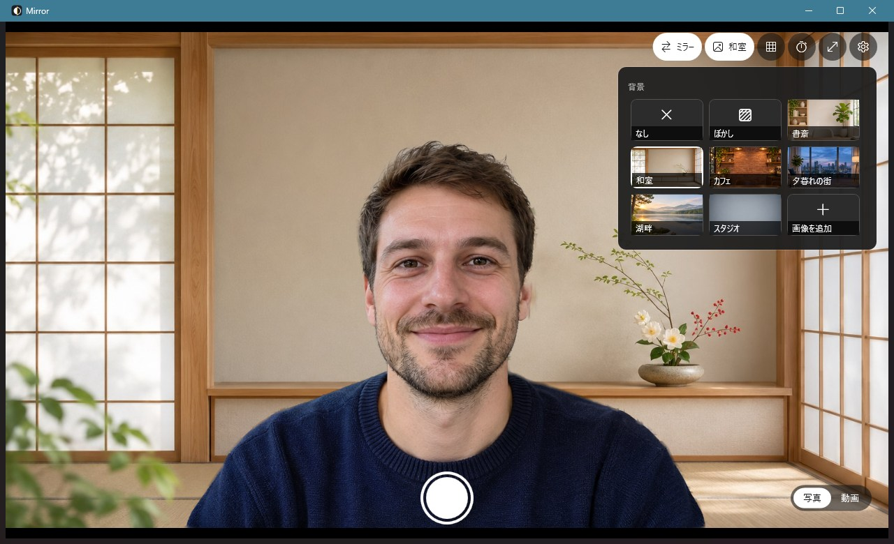

# Mirror

[English](README.md) | **日本語** | [简体中文](README.zh-CN.md)

Windows 11 標準の「カメラ」アプリの代わりに使う、ネイティブのカメラアプリです。



## 作った理由

Windows 11 に付属の「カメラ」アプリは使いにくく、基本的な機能すらありません。

- ミラー（左右反転）がない。画面を鏡代わりに身だしなみを確認すると、左右が逆に映る。
- 背景ぼかしや背景の置き換えがない。部屋がそのまま映り込む。
- 調整できる項目がほとんどなく、撮れたものをそのまま使うしかない。

Mirror はこうした基本機能を補うために作りました。起動してすぐ使え、ミラーはワンクリックで切り替えられ、背景はぼかしや置き換えができ、写真にも動画にも効果がかかります。

WPF（.NET 10）と Windows 標準の `MediaCapture` / Media Foundation で作られており、Windows 11 の Fluent ダークテーマを使っています。

## 機能

- **ミラー**：ワンクリックで切り替え、初期状態はオン。写真や動画もミラーのまま保存するかは設定で選べます。初期設定では、画面に見えているとおりに保存されます。
- **写真・動画**：写真は JPEG、動画は MP4（H.264 + AAC）で保存します。
- **背景**：なし、ぼかし（強さを調整可能）、内蔵の 6 種類のシーン、動く背景「オーロラ」、または自分の画像・GIF・動画（MP4、MOV、WMV など）。動く背景はループ再生されます（動画の音声は使いません）。写真にも動画にも適用されます。
- **タイマー**：3 秒または 10 秒のカウントダウン。
- **補助**：三分割グリッド、全画面表示。
- **画質の調整**：カメラの切り替え、解像度とフレームレートの選択、明るさとコントラストの調整（カメラが対応している場合）。
- **アルバム**：左下のサムネイルをクリックすると、Windows「フォト」のギャラリーが開きます。
- **プライバシー**：
  - マイクは録画中だけ使い、写真と動画の切り替えでカメラを開き直しません。
  - ウィンドウを最小化するとカメラを解放します（録画中を除く）。
  - 人物の切り抜きはすべてこの PC 上で処理し、映像は外部に送信されません。
- **表示言語**：簡体字中国語、英語、日本語。初期設定では Windows の表示言語に合わせ、設定から切り替えるとすぐに反映されます。
- **設定を記憶**：終了しても選択内容を保持します。

## キーボードショートカット

| キー | 動作 |
| --- | --- |
| スペース / Enter | 写真を撮る、または録画の開始・停止 |
| `M` | ミラーのオン・オフ |
| `B` | 背景効果のオン・オフ（「なし」と前回使った背景を切り替え） |
| `V` | 写真 / 動画の切り替え |
| `T` | タイマー：オフ → 3 秒 → 10 秒 |
| `G` | グリッド |
| `C` | カメラの切り替え（複数ある場合） |
| `S` | 設定パネル |
| `F11` | 全画面表示 |
| `Esc` | カウントダウンの取り消し / パネルを閉じる / 全画面の解除 |

## 保存場所

| 内容 | 場所 |
| --- | --- |
| 写真と動画 | `ピクチャ\Camera Roll`（標準カメラと同じフォルダー）、ファイル名は `Mirror_日付_時刻.jpg/.mp4` |
| 設定 | `%LOCALAPPDATA%\Mirror\settings.json` |
| アップロードした背景 | `%LOCALAPPDATA%\Mirror\backgrounds\`（コピーを保存するので、元の画像を移動しても使えます） |
| 録画の一時ファイル | `%LOCALAPPDATA%\Mirror\recording\`（自動で削除されます） |

## 動作環境

- Windows 10 2004（ビルド 19041）以降。Windows 11 を推奨。
- [.NET 10 デスクトップ ランタイム](https://dotnet.microsoft.com/download/dotnet/10.0)（フレームワーク依存で発行しています）。
- Windows のプライバシー設定で「デスクトップ アプリにカメラへのアクセスを許可する」をオンにしてください。動画に音声を入れるにはマイクへのアクセスも必要です。
- 背景効果には DirectX 12 対応のグラフィックスカードがあると快適です。ない場合は CPU で処理し、解像度を下げるぶん負荷が上がります。

## ビルド

.NET 10 SDK が必要です。

```bash
dotnet build -c Release
```

単一の exe として `dist\Mirror.exe` に発行するには：

```bash
dotnet publish -c Release -r win-x64 --self-contained false -p:PublishSingleFile=true -p:DebugType=none -o dist
```

README 用のスクリーンショットは、実際のカメラや人物を使わずに撮れます。静止画をカメラの代わりにして起動します（このモードでは設定は保存されません）：

```bash
Mirror.exe --demo docs/demo-subject.jpg --lang ja --background preset:japan
```

`docs/demo-subject.jpg` の人物は Codex（gpt-image）で生成した架空の人物です。

発行後、`dist` に `DirectML.pdb`、`DirectML.Debug.pdb`、`onnxruntime.lib` が残ります。実行には不要なので削除してかまいません。

## コード構成

| ファイル | 役割 |
| --- | --- |
| `MainWindow.xaml` / `.cs` | 画面、ボタンとショートカット、背景の選択パネル、撮影と録画の流れ |
| `CameraService.cs` | カメラのオープン、フレーム取得、録画（システム録画と独自エンコードの 2 経路）、マイク |
| `BackgroundBlur.cs` | 人物の切り抜き（Robust Video Matting）、背景ぼかしと背景置き換えの合成 |
| `Backgrounds.cs` | 内蔵背景とユーザーの背景：一覧、読み込み、アップロード、削除 |
| `AnimatedBackgrounds.cs` | 動く背景：動画のデコード、GIF の合成、「オーロラ」の描画、専用スレッドでの再生 |
| `FrameEncoder.cs` | 背景効果がオンのとき、処理後の映像を H.264 MP4 にエンコード |
| `Remuxer.cs` | 別々に録った映像と音声を、再エンコードせずに 1 つの MP4 にまとめる |
| `MediaFoundation.cs` | Media Foundation のインターフェースと GUID（Windows SDK のヘッダーから取得） |
| `AppSettings.cs` | 設定の読み書き |
| `Loc.cs` | 画面の文言（中国語・英語・日本語）と、言語ごとのフォント切り替え |
| `assets/` | アイコン、モデル、内蔵背景、サードパーティのライセンス表記 |

### 録画の 2 つの経路

- **背景効果なし**：Windows の `MediaCapture` がカメラから直接録画します。ミラーはシステムの映像変換エフェクトで行います。
- **背景効果あり**：処理後の各フレームを `FrameEncoder` に送り、使える場合はグラフィックスカードのハードウェアエンコーダーを使います。タイムスタンプは各フレームの撮影時刻です。

どちらの場合も音声は別の `MediaCapture` で録音し、終了時に `Remuxer` が開始時刻を合わせて 1 つにまとめます。

### 素材

- **アイコン**：`assets/make-icon.ps1` がコードで描画しています。
- **内蔵背景**：`assets/backgrounds/` にあり、Codex（gpt-image）で生成して 16:9 に切り出し、JPEG に圧縮しています。同じ名前のファイルに差し替えて発行し直せば変更できます。

## 既知の制限

- **誤検出**：画面に誰もいないとき、人物の切り抜きモデルが濃い色の服などを人物と判断し、画面に残すことがあります。
- **背景の向き**：ミラーがオンで「ミラーのまま保存」がオフのとき、写真の置き換え背景は左右反転して保存されます。
- **フレーム落ち**：背景効果ありで録画中、PC の処理が追いつかない場合はプレビューの滑らかさを優先してフレームを落とすため、動画がなめらかでなくなります。
- **音声の同期**：音声と映像は開始時刻で合わせています。拍手などによる厳密な同期の確認はまだ行っていません。
- **1 ウィンドウのみ**：カメラは排他的に使うため、Mirror は同時に 1 つしか起動できません。カメラを使っている他のアプリも先に閉じてください。

## ライセンス

Mirror は **GNU General Public License v3.0** で公開しています。詳しくは [LICENSE](LICENSE) を参照してください。

サードパーティのコンポーネント：

- **人物の切り抜きモデル**：[Robust Video Matting](https://github.com/PeterL1n/RobustVideoMatting)、GPL-3.0。改変せずに同梱しています。
- **ONNX Runtime**：MIT ライセンス。

詳しくは [assets/THIRD_PARTY_NOTICES.txt](assets/THIRD_PARTY_NOTICES.txt) を参照してください。
