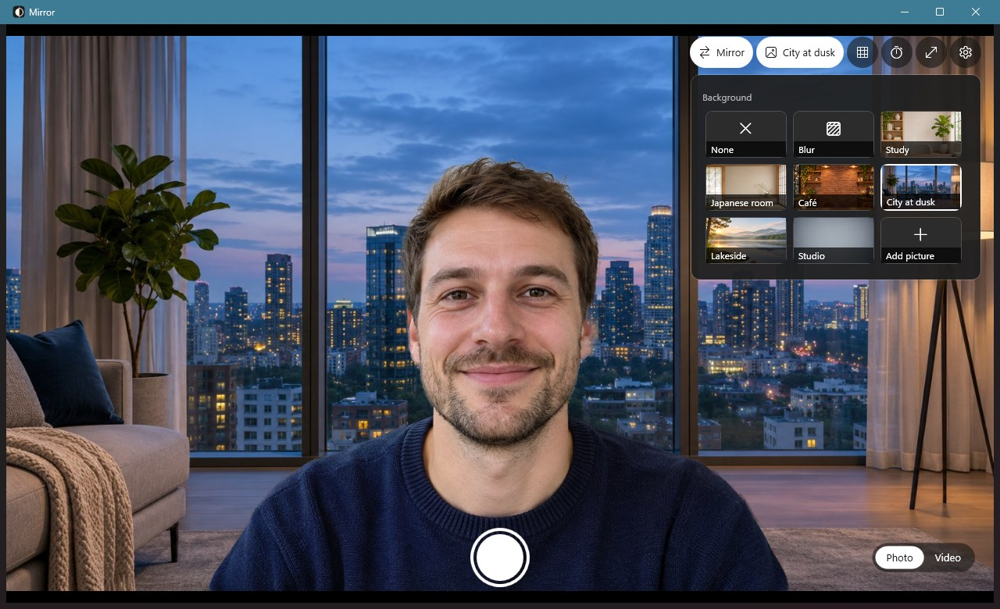

# Mirror

**English** | [日本語](README.ja.md) | [简体中文](README.zh-CN.md)

A native camera app for Windows 11, made to replace the built-in Camera app.



## Why

The Camera app that ships with Windows 11 is frustrating to use and is missing even the basics:

- No mirror option. When you use it as a mirror to check how you look, the picture is the wrong way round.
- No background blur or replacement. Whatever is in your room ends up in the shot.
- Very little you can adjust. You get what it gives you.

Mirror fills in those basics. It opens straight into the camera, mirroring is one click, the background can be blurred or replaced, and the effects apply to both photos and videos.

It is built with WPF (.NET 10) on Windows' own `MediaCapture` and Media Foundation, with the Windows 11 Fluent dark theme.

## Features

- **Mirror**: one-click toggle, on by default. A setting decides whether photos and videos are saved mirrored too; by default they are saved as you see them.
- **Photos and video**: photos are saved as JPEG, videos as MP4 (H.264 + AAC).
- **Background**: none, blur (adjustable strength), six built-in scenes, the animated "Aurora", or your own picture, GIF or video (MP4, MOV, WMV and more). Animated backgrounds loop; videos are used without their sound. The effect is applied to both photos and videos.
- **Timer**: 3-second or 10-second countdown.
- **Helpers**: rule-of-thirds grid, full screen.
- **Picture settings**: switch camera, choose resolution and frame rate, adjust brightness and contrast (when the camera supports it).
- **Gallery**: click the thumbnail in the bottom-left corner to open the Windows Photos gallery.
- **Privacy**:
  - The microphone is opened only while recording, and switching between photo and video does not restart the camera.
  - The camera is released while the window is minimised, unless a recording is running.
  - Person segmentation runs entirely on your PC; no image leaves the computer.
- **Interface languages**: Simplified Chinese, English and Japanese. Follows the Windows display language by default, and can be changed in settings with immediate effect.
- **Remembers your settings** between sessions.

## Keyboard shortcuts

| Key | Action |
| --- | --- |
| Space / Enter | Take a photo, or start / stop recording |
| `M` | Toggle mirror |
| `B` | Toggle background effect: switches between "none" and the last background used |
| `V` | Switch between photo and video |
| `T` | Timer: off → 3 s → 10 s |
| `G` | Grid |
| `C` | Switch camera (when there is more than one) |
| `S` | Settings panel |
| `F11` | Full screen |
| `Esc` | Cancel countdown / close panel / leave full screen |

## Where files are saved

| What | Where |
| --- | --- |
| Photos and videos | `Pictures\Camera Roll` (the same folder as the Windows Camera app), named `Mirror_date_time.jpg/.mp4` |
| Settings | `%LOCALAPPDATA%\Mirror\settings.json` |
| Uploaded backgrounds | `%LOCALAPPDATA%\Mirror\backgrounds\`; a copy is kept, so moving the original does not break it |
| Recording temp files | `%LOCALAPPDATA%\Mirror\recording\`, cleaned up automatically |

## Requirements

- Windows 10 2004 (build 19041) or later; Windows 11 recommended.
- The [.NET 10 Desktop Runtime](https://dotnet.microsoft.com/download/dotnet/10.0); the app is published as framework-dependent.
- In Windows privacy settings, "Let desktop apps access your camera" must be on, and microphone access too for sound in videos.
- Background effects work best with a DirectX 12 graphics card. Without one they fall back to the CPU at a lower resolution and higher load.

## Building

Requires the .NET 10 SDK.

```bash
dotnet build -c Release
```

To publish a single exe to `dist\Mirror.exe`:

```bash
dotnet publish -c Release -r win-x64 --self-contained false -p:PublishSingleFile=true -p:DebugType=none -o dist
```

To take README screenshots without a real camera or a real person, start the app with a still picture in place of the camera. Settings are not saved in this mode:

```bash
Mirror.exe --demo docs/demo-subject.jpg --lang en --background preset:city
```

The person in `docs/demo-subject.jpg` is fictional, generated with Codex (gpt-image).

Publishing also leaves `DirectML.pdb`, `DirectML.Debug.pdb` and `onnxruntime.lib` in `dist`. They are not needed at run time and can be deleted.

## Code layout

| File | Purpose |
| --- | --- |
| `MainWindow.xaml` / `.cs` | UI, buttons and shortcuts, background picker, photo and recording flow |
| `CameraService.cs` | Opening the camera, frames, recording (system or own encoder), microphone |
| `BackgroundBlur.cs` | Person segmentation (Robust Video Matting), background blur and replacement |
| `Backgrounds.cs` | Built-in and user backgrounds: list, load, upload, delete |
| `AnimatedBackgrounds.cs` | Animated backgrounds: video decoding, GIF composition, the drawn "Aurora", and the player thread |
| `FrameEncoder.cs` | Encodes the processed frames to H.264 MP4 when a background effect is on |
| `Remuxer.cs` | Losslessly combines the separately recorded video and sound into one MP4 |
| `MediaFoundation.cs` | Media Foundation interfaces and GUIDs, taken from the Windows SDK headers |
| `AppSettings.cs` | Loading and saving settings |
| `Loc.cs` | Interface text in Chinese, English and Japanese, and the matching font per language |
| `assets/` | Icon, model, built-in backgrounds and third-party notices |

### Two recording paths

- **No background effect**: Windows `MediaCapture` records straight from the camera. Mirroring uses the system's video transform effect.
- **With a background effect**: each processed frame goes to `FrameEncoder`, which uses the graphics card's hardware encoder when available. Timestamps are taken from each frame's capture time.

In both cases a second `MediaCapture` records the sound, and `Remuxer` combines the two, aligned by their start times.

### Assets

- **Icon**: drawn in code by `assets/make-icon.ps1`.
- **Built-in backgrounds**: in `assets/backgrounds/`, generated with Codex (gpt-image), cropped to 16:9 and compressed to JPEG. Replace a file with one of the same name and publish again to change it.

## Known limitations

- **False detections**: with nobody in the frame, the segmentation model may treat dark clothing or similar objects as a person and leave them in the picture.
- **Background direction**: with mirroring on but "save mirrored" off, a replacement background appears flipped in photos.
- **Dropped frames**: when recording with a background effect on a PC that cannot keep up, frames are dropped to keep the preview smooth, so the video is less fluid.
- **Audio sync**: sound and picture are aligned by their start times; precise sync has not been verified with a clap test.
- **One window only**: the camera is used exclusively, so only one Mirror can run at a time, and other apps using the camera must be closed first.

## License

Mirror is licensed under the **GNU General Public License v3.0**; see [LICENSE](LICENSE).

Third-party components:

- **Person segmentation model**: [Robust Video Matting](https://github.com/PeterL1n/RobustVideoMatting), GPL-3.0, included unmodified.
- **ONNX Runtime**: MIT license.

See [assets/THIRD_PARTY_NOTICES.txt](assets/THIRD_PARTY_NOTICES.txt) for details.
