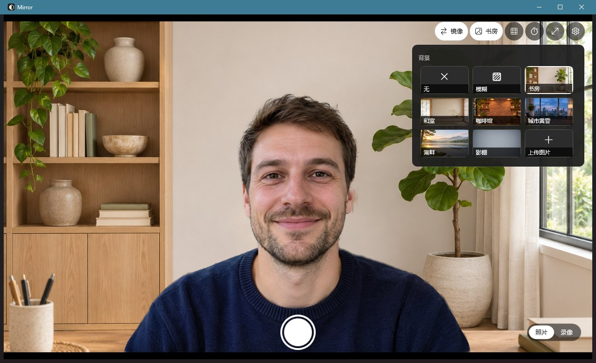

# Mirror

[English](README.md) | [日本語](README.ja.md) | **简体中文**

一个 Windows 11 原生相机应用，用来替代系统自带的“相机”。



## 为什么做这个

Windows 11 自带的“相机”太难用了，连最基本的功能都没有：

- 没有镜像。对着屏幕照镜子、整理仪容时，画面方向是反的。
- 没有背景模糊或背景替换，只能把房间原样拍进去。
- 能调的东西很少，拍出来是什么样就是什么样。

Mirror 就是为了补上这些基本功能：打开就能用，镜像一键开关，背景可以模糊或替换，拍照和录像都能带上效果。

技术上基于 WPF（.NET 9）和 Windows 自带的 `MediaCapture` / Media Foundation，界面使用 Win11 Fluent 深色主题。

## 功能

- **镜像**：一键开关，默认开启。可在设置里选择照片和视频是否也按镜像保存，默认保存的就是你看到的样子。
- **拍照、录像**：照片存为 JPEG，视频存为 H.264 + AAC 的 MP4。
- **背景**：无、模糊（可调强度）、6 张内置预设，或上传自己的图片。照片和录像都会带上背景效果。
- **定时**：可设 3 秒或 10 秒倒计时。
- **辅助**：九宫格、全屏。
- **画面调节**：切换摄像头、选择分辨率和帧率、调节亮度和对比度（需摄像头支持）。
- **相册**：点左下角缩略图，打开 Windows“照片”的图库。
- **隐私**：
  - 麦克风只在录像时打开，切换模式不会重开摄像头。
  - 窗口最小化时释放摄像头，录像中除外。
  - 人像分割全部在本机运行，画面不会上传。
- **界面语言**：简体中文、English、日本語。默认跟随 Windows 语言，也可在设置里切换，立即生效。
- **记住设置**：退出后保留所有选择。

## 快捷键

| 按键 | 作用 |
| --- | --- |
| 空格 / 回车 | 拍照，或开始、停止录像 |
| `M` | 镜像开关 |
| `B` | 背景效果开关：在“无”和上次用的背景之间切换 |
| `V` | 切换照片 / 录像 |
| `T` | 定时：关 → 3 秒 → 10 秒 |
| `G` | 九宫格 |
| `C` | 切换摄像头（有多个时） |
| `S` | 设置面板 |
| `F11` | 全屏 |
| `Esc` | 取消倒计时 / 关闭面板 / 退出全屏 |

## 文件保存在哪

| 内容 | 位置 |
| --- | --- |
| 照片和视频 | `图片\Camera Roll`，和系统相机同一个文件夹，文件名为 `Mirror_日期_时间.jpg/.mp4` |
| 设置 | `%LOCALAPPDATA%\Mirror\settings.json` |
| 上传的背景图 | `%LOCALAPPDATA%\Mirror\backgrounds\`，上传时复制一份，原图移走也不影响 |
| 录像临时文件 | `%LOCALAPPDATA%\Mirror\recording\`，录完自动清理 |

## 运行要求

- Windows 10 2004（19041）或更新版本，推荐 Windows 11。
- 已安装 [.NET 9 桌面运行时](https://dotnet.microsoft.com/download/dotnet/9.0)，程序按依赖框架方式发布。
- 系统设置里要允许“让桌面应用访问你的相机”；录音还需要允许麦克风。
- 背景效果最好有支持 DirectX 12 的显卡。没有时会改用 CPU，分辨率降低、占用升高。

## 构建

需要 .NET 9 SDK。

```bash
dotnet build -c Release
```

发布成单个 exe，输出到 `dist\Mirror.exe`：

```bash
dotnet publish -c Release -r win-x64 --self-contained false -p:PublishSingleFile=true -p:DebugType=none -o dist
```

截 README 用的截图时，不需要真的摄像头和真人：用一张静态图片代替摄像头启动即可，这个模式下不会保存设置：

```bash
Mirror.exe --demo docs/demo-subject.jpg --lang zh --background preset:office
```

`docs/demo-subject.jpg` 中的人物是用 Codex（gpt-image）生成的虚构人物。

发布后 `dist` 里会多出 `DirectML.pdb`、`DirectML.Debug.pdb` 和 `onnxruntime.lib`，运行时用不到，可以删掉。

## 代码结构

| 文件 | 作用 |
| --- | --- |
| `MainWindow.xaml` / `.cs` | 界面、按钮和快捷键、背景选择面板、拍照和录像流程 |
| `CameraService.cs` | 打开摄像头、取帧、录像（系统录制或自编码两条路径）、麦克风 |
| `BackgroundBlur.cs` | 人像分割（Robust Video Matting）、背景模糊与背景替换合成 |
| `Backgrounds.cs` | 预设和用户背景图：列出、加载、上传、删除 |
| `FrameEncoder.cs` | 开启背景效果时，把处理后的画面编码成 H.264 MP4 |
| `Remuxer.cs` | 把单独录的视频和声音无损合成一个 MP4 |
| `MediaFoundation.cs` | Media Foundation 接口声明和 GUID，取自 Windows SDK 头文件 |
| `AppSettings.cs` | 读写设置 |
| `Loc.cs` | 界面文字的中、英、日翻译表，以及按语言切换字体 |
| `assets/` | 图标、模型、预设背景，以及第三方许可说明 |

### 录像的两条路径

- **没有背景效果**：由系统 `MediaCapture` 直接从摄像头录制。镜像用系统的视频变换效果实现。
- **有背景效果**：把处理后的每一帧送进 `FrameEncoder`，可用时调用显卡硬件编码。时间戳取自每帧的采集时间。

两条路径的声音都由另一个 `MediaCapture` 单独录制，结束时再用 `Remuxer` 按开始时间对齐合成。

### 素材

- **图标**：由 `assets/make-icon.ps1` 用代码绘制。
- **预设背景**：位于 `assets/backgrounds/`，由 Codex（gpt-image）生成，裁成 16:9 后压缩为 JPEG。替换同名文件后重新发布即可更换。

## 已知限制

- **误判**：画面里没人时，人像模型可能把深色衣物等当成人，留在画面上。
- **背景方向**：打开镜像但不按镜像保存时，照片里的替换背景是左右反的。
- **掉帧**：开启背景效果录像时，如果电脑处理不过来，会丢帧来保证预览流畅，视频会不那么顺滑。
- **音画同步**：声音和画面按开始时间对齐，还没有做过拍手之类的精确同步测试。
- **单个窗口**：摄像头为独占使用，同时只能开一个 Mirror，其他占用摄像头的应用也要先关闭。

## 许可

Mirror 以 **GNU General Public License v3.0** 发布，详见 [LICENSE](LICENSE)。

第三方组件：

- **人像分割模型**：[Robust Video Matting](https://github.com/PeterL1n/RobustVideoMatting)，GPL-3.0，未经修改直接内置。
- **ONNX Runtime**：MIT 许可。

详见 [assets/THIRD_PARTY_NOTICES.txt](assets/THIRD_PARTY_NOTICES.txt)。
